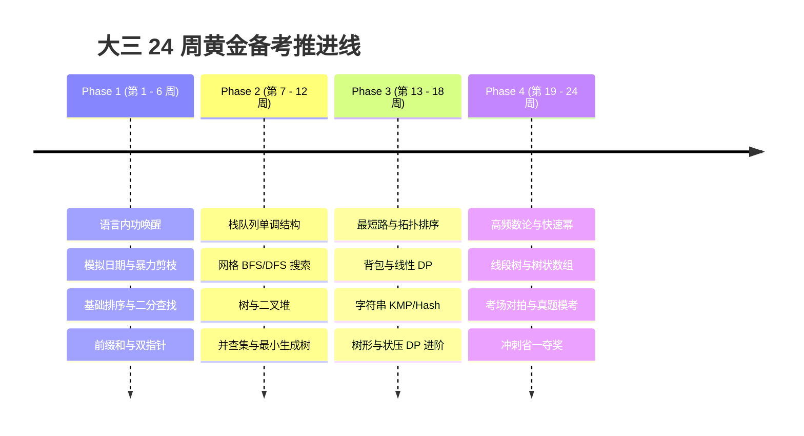

# 大三 24 周精简高 ROI 备战日历（每周 8-10 小时冲刺版）

> **适用对象**：大三零基础学生，需兼顾专业课、考研 408 复习或保研准备，希望通过每周 8–10 小时高效利用夺得蓝桥杯 Python B 组省一/国奖，并打通大厂实习机试与 408 算法大题。

---

## 一、备战阶段总览

---

## 二、每周 8-10 小时黄金时间分配模型

- **周一至周五（工作日：每天 60 - 75 分钟）**：
  - **前 15 分钟（看动画 + 悟原理）**：双击打开本地 `index.html`，播放对应算法的动态演进过程，阅读【算法由来、底层不变量推导与母题识别信号】；
  - **中间 35 分钟（填挖空脚手架）**：打开对应模块的 `practice_scaffold.py`，亲手补齐 `# TODO` 挖空的 5-8 行核心代码，点击 Run 直至所有单元测试 `✅ PASS`；
  - **后 15 分钟（真题巩固）**：前往力扣或洛谷刷 1 道母题，巩固输入输出模式。
- **周末（周六或周日集中 2.5 - 3 小时）**：
  - **复盘与拓展**：运行 `stress_tester.py` 自动对拍生成器，进行随机数据对拍与极限边界测试；
  - **打卡记录**：在 `index.html` 看板上勾选打卡，查看当周完成率与环比提升。

---

## 三、24 周详尽周计划与里程碑

### 第一阶段：筑基破冰与签到保障（第 1 - 6 周）
*目标：拿下蓝桥杯前 3-4 道签到与模拟大题，建立扎实的编程手感。*

- **第 1 周：Python 竞赛内功与极速 I/O**
  - 核心：快读 `sys.stdin.readline`、扩栈、切片操作、`collections.Counter` 与 `defaultdict`。
  - 交付：熟练切换力扣 `class Solution` 模式与 ACM 输入输出模式。
- **第 2 周：模拟题大杀器与日期处理**
  - 核心：`datetime` 模块极速解题、闰年与星期推算、进制转换。
  - 题目：蓝桥杯真题《回文日期》、《顺子日期》。
- **第 3 周：排序全家桶与相向双指针**
  - 核心：冒泡/选择/插入比较，408 必考快速排序双指针 Partition、归并排序。
  - 题目：LeetCode 75 颜色分类、LeetCode 215 快速选择第 K 大。
- **第 4 周：二分查找与红蓝染色终极心法**
  - 核心：有序数组二分边界、单调性反推、二分答案母题设计 `check()` 函数。
  - 题目：LeetCode 704、LeetCode 34 查找左右边界、LeetCode 875 爱吃香蕉的珂珂。
- **第 5 周：一维/二维前缀和与差分数组**
  - 核心：$O(1)$ 区间求和、$O(1)$ 区间批量增减操作、哈希表枚举右维护左。
  - 题目：LeetCode 303 区域和检索、LeetCode 560 和为 K 的子数组、洛谷 P3397 地毯。
- **第 6 周：阶段复盘与基础模考**
  - 使用 `stress_tester.py` 对拍，梳理第一阶段 20 道母题的题眼思维导图。

---

### 第二阶段：结构进阶与搜索图论（第 7 - 14 周）
*目标：突破中档大题，拿下省二奔向省一。*

- **第 7 周：栈、单调栈与括号匹配**
  - 核心：单调栈求“下一个更大元素”、柱状图最大矩形哨兵机制。
  - 题目：LeetCode 20 有效括号、LeetCode 739 每日温度、LeetCode 84 柱状图矩形。
- **第 8 周：双端队列与单调队列**
  - 核心：`collections.deque` 实现滑动窗口最值、队列内单调性维护。
  - 题目：LeetCode 239 滑动窗口最大值、洛谷 P1886 单调队列模板。
- **第 9 周：网格迷宫 BFS 与多源波纹扩展**
  - 核心：队列步长探索、八方向/四方向位移数组、无权图最短路径。
  - 题目：LeetCode 200 岛屿数量、LeetCode 1091 二进制矩阵最短路。
- **第 10 周：深度优先搜索 DFS 与四大回溯剪枝**
  - 核心：递归展开树、状态还原、可行性剪枝与最优性剪枝。
  - 题目：LeetCode 46 全排列、LeetCode 51 N 皇后。
- **第 11 周：二叉堆与优先队列**
  - 核心：`heapq` 模块应用、对顶堆求动态中位数、Top-K 极值维护。
  - 题目：LeetCode 1046 石头重量、LeetCode 295 数据流中位数。
- **第 12 周：并查集 (DSU) 与 Kruskal 最小生成树**
  - 核心：路径压缩、按秩合并、边权升序排序贪心选边。
  - 题目：LeetCode 547 省份数量、洛谷 P3366 最小生成树模板。
- **第 13 周：最短路四剑客 (Dijkstra / Floyd)**
  - 核心：Dijkstra 堆优化贪心松弛、Floyd 三重循环全源最短路。
  - 题目：LeetCode 743 网络延迟时间、洛谷 P4779 单源最短路标准版。
- **第 14 周：拓扑排序与有向无环图 (DAG)**
  - 核心：Kahn 入度消除算法、依赖关系解析与判环。
  - 题目：LeetCode 207 课程表、LeetCode 210 课程表 II。

---

### 第三阶段：动态规划大成与数论字符串（第 15 - 20 周）
*目标：攻克夺奖分水岭大题，锁定省一并冲击国奖。*

- **第 15 周：记忆化搜索到经典线性 DP**
  - 核心：`@lru_cache` 状态记忆、爬楼梯、最大子数组和 Kadane。
  - 题目：LeetCode 70 爬楼梯、LeetCode 53 最大子数组和。
- **第 16 周：背包全家桶 (0-1 背包与完全背包)**
  - 核心：状态定义 `dp[w]`、容量倒序（防重复）与容量正序（无限选）。
  - 题目：LeetCode 416 分割等和子集、LeetCode 322 零钱兑换、洛谷 P1048 采药。
- **第 17 周：经典双序列 DP (LIS 与 LCS)**
  - 核心：最长上升子序列（$O(N^2)$ 与二分 $O(N\log N)$）、最长公共子序列。
  - 题目：LeetCode 300 最长递增子序列、LeetCode 1143 最长公共子序列。
- **第 18 周：树形 DP 与区间 DP**
  - 核心：树上选与不选、石子合并对角线推进。
  - 题目：洛谷 P1352 没有上司的舞会、LeetCode 312 戳气球。
- **第 19 周：初等数论三剑客 (质数/GCD/快速幂)**
  - 核心：埃氏筛、欧几里得辗转相除法、快速幂模运算与费马小定理逆元。
  - 题目：LeetCode 50 快速幂、LeetCode 204 计数质数、洛谷 P3811 乘法逆元。
- **第 20 周：字符串哈希与 KMP 匹配**
  - 核心：双模数滚动哈希、KMP next 数组失配回退。
  - 题目：LeetCode 28 实现 strStr、洛谷 P3370 字符串哈希。

---

### 第四阶段：高级结构、综合骗分与考场全真模考（第 21 - 24 周）
*目标：融会贯通，掌握暴力骗分技巧与全真赛场心态。*

- **第 21 周：树状数组 (BIT) 与基础线段树**
  - 核心：`lowbit(x)` 动态前缀和维护、单点更新区间查询。
  - 题目：洛谷 P3374 树状数组模板 1。
- **第 22 周：OI 赛制四阶骗分法则与特判技巧**
  - 核心：阅读《02_看数据范围N秒推算法与OI赛制四阶骗分法则.md》，掌握打表找规律、小数据爆搜骗 30% 分数战术。
- **第 23 周：近三年蓝桥杯 Python B 组真题模考 (4小时全真闭卷)**
  - 检验做题时间节奏：前 60 分钟攻克签到与模拟，中间 90 分钟做中档搜索/DP，最后 90 分钟对压轴大题写暴力对拍骗分。
- **第 24 周：考前工具箱复习与心态调节**
  - 检查快读、扩栈模板熟练度，查漏补缺，轻松上阵！
